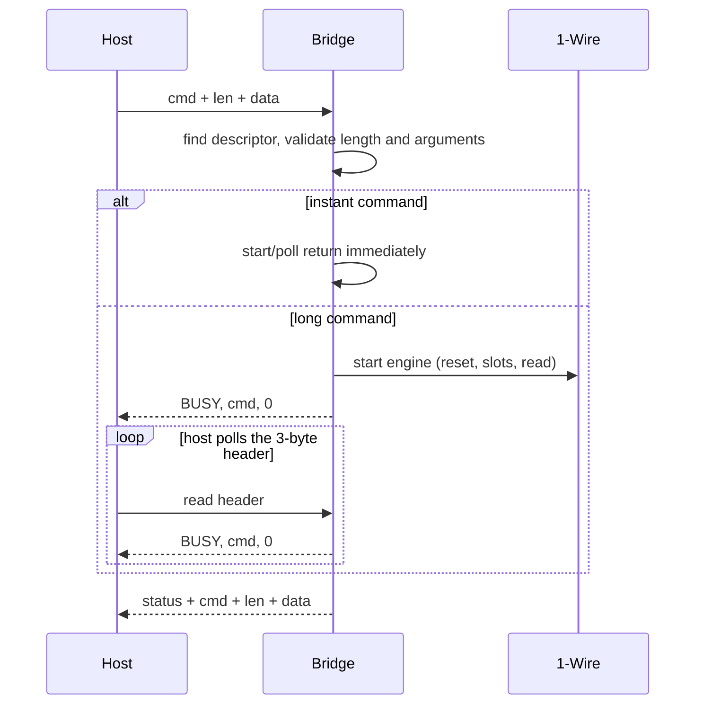

# How the bridge works - an illustrated tour

This is not an API reference. It is a walk through one command at a time, using
traffic captured on the real 9-device bench: 7 x DS18B20, 1 x DS2431 EEPROM and
1 x DS2413 PIO, all parasite-powered, with a CH341A USB-I2C master at address
`0x30`.

The point is to show what the host sends, what the firmware does with it, and
what comes back - including the boring cases (a queued command, a rejected
frame) that are easy to miss in a command table.

## The shape of the system

```text
   host                                 STM32F030F4P6                  bus
+-----------+    I2C / SPI / UART    +------------------------+    TIM1+DMA    +---------+
| demo or   | <====================> | host_*.c -> bridge.c   | <============> | 1-Wire  |
| firmware  |                        | cache, config, stats   |                | devices |
+-----------+                        +------------------------+                +---------+
```

The host interface is compiled in (`HOST_IF=UART|SPI|I2C`); only one `host_*.c`
is linked. Everything above the transport is shared: the same command byte,
the same descriptor table and the same state machine.

The firmware is fully polled. No NVIC interrupts are enabled, and the 1-Wire
waveforms are generated by TIM1 and DMA, so the CPU only starts an operation
and later asks "done?".

## One frame, one command

Both directions use the same small frame:

```text
Command:   [cmd] [len] [data...]
Response:  [status] [cmd] [len] [data...]
```

`len` is the payload length, 0..40. The response always echoes the command
byte, even while it is still `BUSY`. That echo is what lets the host tell a
real answer from a lost write.

A single `CONFIG_GET` on the I2C build looks like this (`--verbose`):

```text
TX 60 50 00
RX 00 50 28
RX 00 50 28 52 42 57 4f 00 01 30 04 ... 7c 0b fd 98
```

- `60` is `0x30 << 1 | write`; `50 00` is the command and an empty payload.
- `00 50 28` is `OK`, `CONFIG_GET`, 40 data bytes.
- The third line is the 40-byte configuration block, read in a second I2C
  transaction.

Long captures below are trimmed with `...`; the shapes and values are from the
real runs.

On UART the frame is wrapped in `AA 55` / `5A A5` and a CRC-8; SPI uses the
bare frame between two CS phases, and the I2C slave uses the bare frame above.
Neither SPI nor I2C has a transport checksum (see the README for the integrity
matrix).

### What happens inside



An **instant** command is completed inside `bridge_submit()` before the I2C
STOP handler returns: cached queries, configuration, statistics. A **long**
command starts the 1-Wire engine and answers `BUSY`; the main loop finishes it
while the host keeps polling. Nothing blocks.

### What can go wrong

- **No checksum on SPI/I2C.** A bit flip that keeps the length plausible is
  not detected by the transport; only UART has a CRC-8. Payloads with their own
  check (ROM CRC-8, DS2431 CRC-16, config CRC-32) are still protected.
- **A missed START while a long command runs.** The polled slave does not
  sample SCL during one `bridge_poll()` step after STOP. A transaction that
  starts within that window is lost; the host sees a NACK or `FF FF` and must
  retry, or leave a gap after STOP.
- **`CONFIG_SET` and `EEPROM_WRITE` are irreversible.** Both now verify the
  complete payload before erasing or copying; a bad block is rejected with
  `CRC_ERROR` / `PARAM_ERROR` and the stored data is unchanged. `CONFIG_SET`
  also blocks the polled I2C sampler while the flash page is erased and
  programmed, so the host must retry across it.
- **A wedged I2C bus.** The 50 ms valve releases `bridge_poll()` only when no
  SCL/SDA edge has been seen for 50 ms; a live frame, however slow, keeps the
  1-Wire state machine deferred but is never cut in half.

The dispatch table has one entry per command:

```c
typedef struct {
    void (*start)(const br_command_t *cmd);
    uint8_t (*poll)(br_response_t *resp);
    uint8_t instant;
    uint8_t min_len;
    uint8_t max_len;
    uint8_t flags;
} br_cmd_desc_t;
```

`min_len`/`max_len` and the `flags` word are checked before a command reaches a
handler. The 256-entry table still fits in 3072 bytes because the structure is
12 bytes either way.

## Captured: a command that waits in line

The queue is two entries deep. A broadcast Convert T keeps the bus busy for
750 ms; `OW_GET_COUNT` submitted behind it is accepted immediately and reports
`BUSY` with its own command code:

```text
Submit a 750 ms broadcast Convert T, then OW_GET_COUNT while it runs.

t+ms   status  cmd   name          data
0.7    BUSY    0x0F  OW_GET_COUNT  -
760.6  OK      0x0F  OW_GET_COUNT  09

Queue full
rejected           0x0F OW_GET_COUNT (depth 2 is already occupied)
```

Two things are worth noticing:

- the bridge keeps only the **latest** response, so the conversion's own
  completion can be replaced by the queued command before the host reads it;
- a third entry is rejected with `QUEUE_FULL`, not silently dropped. The host
  can decide whether to retry.

## Captured: finding the devices

`scan` performs a search and then reads the ROM cache:

```text
presence           yes
search found       9
cache count        9

#  ROM (bus order)          family        crc  Dallas label
0  28 20 78 92 07 00 00 67  0x28 DS18B20  ok   28-00000792782067
...
7  3A 9F 47 03 00 00 00 3A  0x3A DS2413   ok   3A-00000003479F3A
8  2D F8 47 60 26 00 00 69  0x2D DS2431   ok   2D-0000266047F869
```

The search walks the 1-Wire binary tree and fills a 16-slot cache. Every ROM
is checked with the Dallas CRC-8. `OW_GET_DEVICES` later returns the cache
without touching the bus, which is why it is one of the instant commands.

## Captured: a temperature conversion

`temp` does what the DS18B20 datasheet describes: one Convert T, then one
scratchpad read per sensor.

```text
Convert T (broadcast)
  status             OK
  busy polls         1710
  elapsed            0.770 s

Temperatures
  ROM                C        resolution                  TH/TL      parasite
  ---------------------------------------------------------------------------
  28-00000792782067  26.6000  12 bit (0.1 C/bit, 750 ms)  +25 / +15  yes
  28-00000BACB8782C  26.9000  12 bit (0.1 C/bit, 750 ms)  +75 / +70  yes
  ...
```

The conversion takes 750 ms at 12-bit resolution; that is the `BUSY` period the
host sees. The bridge reads each scratchpad by ROM, converts the 16-bit word
to **0.1 C units**, and returns two bytes per sensor. The demo prints the
temperature with `/10`.

`TEMP_READ_ALL` is a long command too: about 189 ms for seven sensors, because
each scratchpad read is a separate 1-Wire transaction.

## Captured: a raw DS18B20 conversation

The temperature command is convenient, but the bridge also exposes the bus.
This four-command sequence is exactly what `TEMP_READ` automates:

```text
# 1. reset, check for presence
TX 60 01 00
RX 01 01 00          BUSY
RX 00 01 02 01 00    OK, present=1, short=0

# 2. select one device
TX 60 06 08 28 20 78 92 07 00 00 67
RX 00 06 00          OK (after 30 BUSY polls)

# 3. ask for the scratchpad
TX 60 02 01 be
RX 00 02 00

# 4. read 9 bytes
TX 60 05 01 09
RX 00 05 09 ab 01 19 0f 7f ff 05 10 c8
```

Decode the nine bytes:

| Bytes | Meaning | Value |
|-------|---------|-------|
| `AB 01` | temperature, 1/16 C per LSB | `0x01AB` = 427 -> **26.6875 C** |
| `19` | TH | +25 C |
| `0F` | TL | +15 C |
| `7F` | configuration | 12-bit resolution |
| `FF` | reserved | - |
| `05` | count remain | - |
| `10` | count per C | - |
| `C8` | CRC-8 | valid |

This is also the reason the protocol has `OW_MATCH_ROM` and payload limits: a
ROM is always exactly eight bytes, and the 1-Wire engine can send at most 32
payload bytes (256 slots) in one go.

## Captured: saying no to a bad frame

Every command is validated before it is queued. A wrong length never reaches a
handler and never touches the bus:

```text
PASS  matrix     OW_WRITE_BYTE len=0  [PARAM_ERROR cmd=0x02 len=0]
PASS  matrix     OW_MATCH_ROM len=7   [PARAM_ERROR cmd=0x06 len=0]
PASS  matrix     TEMP_CONVERT len=7   [PARAM_ERROR cmd=0x20 len=0]
PASS  args       TEMP_READ rom[0]=0   [PARAM_ERROR cmd=0x21 len=0]
PASS  structure  padded frame         [PARAM_ERROR cmd=0x0F len=0]
PASS  structure  1-byte frame is unanswered
```

The ranges are grouped in the descriptor table:

| Payload length | Commands |
|----------------|----------|
| 0 | reset, read byte/ROM, status, count, cache clear, abort, read-all, config/version/stats |
| 1 | write byte, read bytes, pull-up, power |
| 2 | get devices |
| 1..32 | write bytes, skip ROM |
| 0..3 | search |
| 0..1 | alarm search |
| 0 or 8 | `TEMP_CONVERT` (broadcast or addressed) |
| 8 | `TEMP_READ`, `TEMP_GET_RES`, `TEMP_GET_ALARM`, `TEMP_COPY`, `TEMP_RECALL`, `TEMP_DETECT_P`, `EEPROM_READ_S`, `IO_READ` |
| 8..40 | `OW_MATCH_ROM` |
| 9 | `TEMP_SET_RES`, `IO_WRITE` |
| 10 | `TEMP_SET_ALARM`, `EEPROM_READ` |
| 10..17 | `EEPROM_WRITE` |
| 40 | `CONFIG_SET` |

A few arguments are checked by value as well: the first ROM byte must be
nonzero (an all-zero ROM is `PARAM_ERROR`, not a silent broadcast), the read
count is 1..32, resolution bits are 9..12, EEPROM length is 1..8, and
`TEMP_CONVERT` accepts either an empty payload or exactly eight bytes.

Unknown command codes answer `INVALID_CMD`. A frame shorter than two bytes
cannot even be parsed, so it is not answered; the previous response stays
latched.

## Captured: an hour at full speed

The 60-minute torture run kept the bus near saturation while injecting
malformed frames, stale buffers, queue/abort churn and parser fuzz:

| Metric | Value |
|--------|-------|
| Bulk 163-byte reads | 252 646 |
| Transactions | 776 677 |
| Bytes read | 42.0 MB |
| Read rate | 11.66 KB/s |
| Bad responses / firmware errors / resets | 0 / 0 / 0 |
| Bulk latency min / avg / max | 13.377 / 13.607 / 52.242 ms |

The bulk loop occupied roughly 95% of wall time. The only recoverable effect
was an occasional NACK on a write address phase (a START that arrived while
the firmware was completing a long-command poll step); the harness resent the
frame, exactly like the demo does. Details:
[`i2c-torture-test.md`](i2c-torture-test.md).

## Latency, in two numbers

```text
FIRMWARE_VER (instant)   1.19 ... 3.21 ms end to end
OW_GET_COUNT (instant)   1.19 ... 1.24 ms
CONFIG_GET (instant)     4.32 ... 4.38 ms
OW_RESET                 2.35 ... 2.82 ms (3.2 polls)
TEMP_READ_ALL            188.4 ... 189.4 ms (414 polls)
```

The millisecond figures are dominated by the USB adapter. Inside the firmware,
the worst instant command (`OW_GET_DEVICES` with nine cached ROMs) takes about
**10 us** from STOP detection to the latched response, which is why the CH341A
can chain a write and a read with its ~15 us gap and still see the answer.
That does **not** apply to long commands: the first `bridge_poll()` after STOP
can take tens of microseconds, so a chained START may be missed and retried
(see [`i2c-timing.md`](i2c-timing.md)).

## Where the code lives

| File | Role |
|------|------|
| `src/main.c` | main loop, watchdog, host poll plus `bridge_poll()` |
| `src/host_i2c_soft.c` | polled I2C slave on PA4/PA5, address `0x30` |
| `src/bridge.c` | command table, validation, queue, start/poll state machine |
| `src/cache.c` | 16-slot ROM cache filled by search |
| `src/config.c` | 40-byte configuration block in the last flash page |
| `src/stats.c` | error counters and uptime |
| `tools/owbridge_demo.py` | host demo and transport reference |
| `tools/protocol_test.py` | boundary and fuzz tests |

A good reading order is `bridge.h` (frame and command codes), then
`bridge_submit()` and `bus_start_next()`, then the `start_*`/`poll_*` pair for
one command family (`OW_RESET` is the smallest), then `host_i2c_soft.c`.

## Run it yourself

```text
python owbridge_demo.py scan
python owbridge_demo.py temp
python owbridge_demo.py watch --interval 1
python owbridge_demo.py queue
python owbridge_demo.py raw 0x50 --verbose
python owbridge_demo.py selftest
```

`--json` makes any scenario scriptable; `--verbose` prints every I2C frame;
`--speed 20k` slows the adapter down if a bus needs it. The full command table,
status codes and build instructions are in the [README](../README.md).
